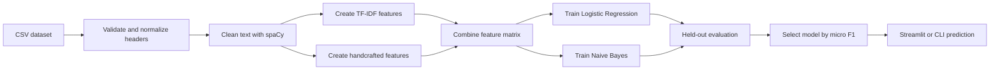

# PersonDate Scout

**A practical sentence-level classification tool for identifying person-related and date-related information.**

PersonDate Scout processes English sentences to classify whether they contain information about a person and whether they contain a date. It compares two conventional text-classification baselines and provides a local Streamlit interface and a command-line workflow.

> This project performs sentence-level multi-label classification. It does not perform token-level named-entity recognition, return entity character offsets, or replace a production extraction service.

## Why it exists

Teams often need a lightweight first-pass filter to identify whether text mentions people or dates before routing it for review or further extraction. PersonDate Scout demonstrates that workflow using a small, inspectable dataset and a transparent machine-learning pipeline.

### Example

```text
Elon Musk founded Tesla on March 1, 2003
```

| Label | Result |
|---|---|
| Person-related | Detected |
| Date-related | Detected |

## Target users and use cases

- Students and engineers learning a complete text-classification workflow.
- Product and operations teams evaluating whether incoming text mentions people or dates.
- FDE-style technical demonstrations requiring CSV ingestion, model training, evaluation, and live classification.
- Engineering teams seeking a simple baseline before implementing a larger NLP service.

Practical examples include document triage, meeting-note screening, and prioritizing text that contains named people or temporal references. Human review is required for ambiguous or high-impact decisions.

## How it works



### ML methodology

- **TF-IDF:** converts processed text into numeric unigram and bigram features based on term frequency and inverse document frequency.
- **Handcrafted features:** adds a capitalization signal, year-pattern signal, and processed-sentence length.
- **Logistic Regression:** learns linear feature weights and provides a strong text-classification baseline.
- **Multinomial Naive Bayes:** provides a fast probabilistic baseline suitable for sparse text features.
- **Multi-label output:** each model predicts both `person` and `date` independently.
- **Model selection:** the interface selects the model with the higher micro-averaged F1 score.
- **Confidence:** displayed probabilities come from estimator `predict_proba` methods. They indicate model confidence, not calibrated real-world accuracy.

The TF-IDF vocabulary is fitted only on the training partition. Handcrafted features are generated for the same processed-text representation used during training and prediction.

## Dataset

The included `ner_data.csv` uses this schema:

| Column | Meaning | Accepted header |
|---|---|---|
| `Sentence` | English sentence to classify | `Sentence` |
| `Name` or `Person` | Person annotation; empty means no person label | `Name` or `Person` |
| `Date` | Date annotation; empty means no date label | `Date` |

The inner project dataset contains 9 source rows. Synthetic augmentation creates additional person/date negative examples by replacing labeled text with placeholders. Source variants are kept in the same train or test partition to reduce duplicate-row leakage.

### Dataset limitations

- The source data is very small and domain-specific.
- Synthetic negatives may not represent natural negative text.
- Metrics are not evidence of production performance or generalization.
- No external benchmark or inter-annotator agreement study is included.

## Architecture

PersonDate Scout is a small, in-memory Python application. It has no database, API server, queue, authentication service, or external AI dependency.

- `ner_project.py`: CSV validation, preprocessing, augmentation, split logic, feature engineering, models, evaluation, and CLI.
- `app.py`: Streamlit layout, CSV upload/path input, model presentation, and prediction export.
- `tests/test_ner_project.py`: functional tests for loading, validation, preprocessing, grouping, training, and prediction.
- `ner_data.csv`: bundled demonstration dataset.
- `README.md`: public project documentation.
- `PROJECT_AUDIT.md`: internal implementation and portfolio audit.
- `docs/ARCHITECTURE.md`: system and processing architecture.
- `docs/METHODOLOGY.md`: model methodology and limitations.

## Technology stack

| Area | Technology |
|---|---|
| Language | Python 3.10+ |
| Data | pandas |
| NLP preprocessing | spaCy blank English pipeline |
| Feature extraction | scikit-learn TF-IDF |
| Models | scikit-learn Logistic Regression and Multinomial Naive Bayes |
| Evaluation | scikit-learn metrics |
| Visualization | Matplotlib and Seaborn |
| Interface | Streamlit |
| Testing | pytest |

The current application does not load or require the pretrained `en_core_web_sm` spaCy model.

## Installation

### Windows PowerShell

Run commands from the project folder containing `app.py`:

```powershell
cd C:\Users\HP\Desktop\IDS-Project\IDS-Project
python -m venv .venv
.\.venv\Scripts\Activate.ps1
python -m pip install --upgrade pip
python -m pip install -r requirements.txt
```

### macOS or Linux

```bash
cd IDS-Project
python3 -m venv .venv
source .venv/bin/activate
python -m pip install --upgrade pip
python -m pip install -r requirements.txt
```

## Run the Streamlit application

```bash
streamlit run app.py
```

Open the local URL printed by Streamlit. In the app:

1. Upload a CSV or enter a file path.
2. Select **Load data and train models**.
3. Review model metrics and held-out confusion matrices.
4. Enter or retain the sample sentence.
5. Select **Analyze sentence**.
6. Optionally export the dataset or prediction result.

## Run the CLI

```bash
python ner_project.py --csv-path ner_data.csv
```

The CLI prints metrics, opens confusion-matrix plots, and asks for an optional sentence to classify. If no `--csv-path` is supplied, it defaults to `ner_data.csv`.

## Run tests

```bash
python -m pytest -q
```

Tests cover CSV loading and validation, preprocessing, handcrafted features, grouped splits, training, prediction, and invalid input.

## CSV rules

- The file must include `Sentence`, `Person`/`Name`, and `Date` columns.
- Header names are case-insensitive and surrounding whitespace is removed.
- Sentence fields cannot be empty.
- Missing person/date values are treated as empty labels.
- The application validates the dataset before training.

## Reproducibility

The pipeline uses `RANDOM_STATE = 42`, a 20% held-out partition by default, and the same vectorizer configuration for both baselines. Synthetic variants from the same source CSV row are kept together during the split.

No model artifacts or published benchmark metrics are committed. Reported results should be generated and verified from the current environment rather than assumed.

## Limitations

- Not a conventional or token-level NER implementation.
- Small and narrow demonstration dataset.
- Synthetic negative examples can overstate confidence and generalization.
- No model persistence, API, database, authentication, or batch service.
- No cross-validation or external benchmark.
- Probabilities are not guaranteed to be calibrated.
- Sensitive or high-impact classifications require human review.

## Future improvements

- Replace synthetic negatives with a larger, reviewed, real-world dataset.
- Add cross-validation and per-label precision/recall/F1 reporting.
- Calibrate probabilities and analyze confidence thresholds.
- Persist fitted vectorizers and models with metadata.
- Add an API and batch-processing endpoint.
- Add true token-level entity spans if product requirements demand it.
- Add automated CI, linting, and Streamlit smoke tests.

## License

No license file is currently included. Add an appropriate license before publishing or redistributing the project.
