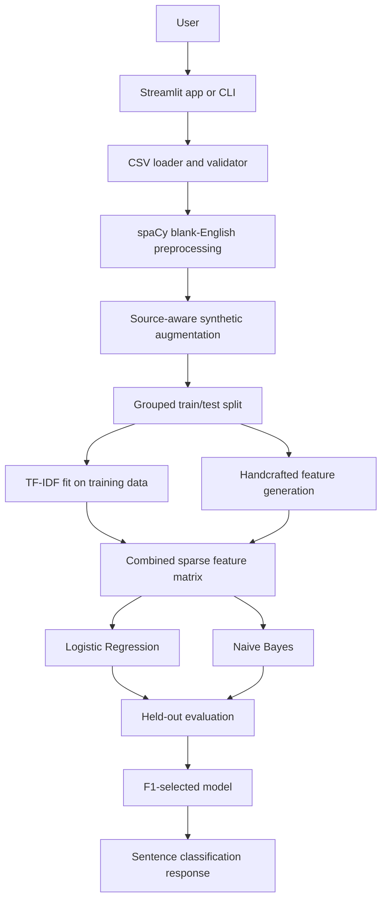

# PersonDate Scout Architecture

## Runtime model

PersonDate Scout is a local, in-memory Python application. It has no database, remote API, queue, or persistent model service.

## Responsibilities

- `ner_project.py` owns data validation, preprocessing, augmentation, splitting, training, evaluation, prediction, and the CLI.
- `app.py` owns Streamlit navigation and presentation.
- `tests/test_ner_project.py` validates core behaviors.
- `ner_data.csv` is the local demonstration dataset.

## Data flow

1. Load and validate `Sentence`, `Person`/`Name`, and `Date` columns.
2. Convert person/date annotations to binary labels.
3. Preprocess source and synthetic sentences with lowercase, tokenization, stop-word removal, and alphabetic filtering.
4. Generate controlled negative variants.
5. Keep augmented variants from the same source row in the same split partition.
6. Fit TF-IDF only on training text.
7. Combine TF-IDF with capitalization, year, and sentence-length features.
8. Train both baselines.
9. Evaluate on held-out source groups.
10. Select the model with the highest micro-averaged F1 score.

## Persistence

No trained model or vectorizer is persisted. Every training session is in memory. This keeps the prototype simple but means cold starts retrain the models.
